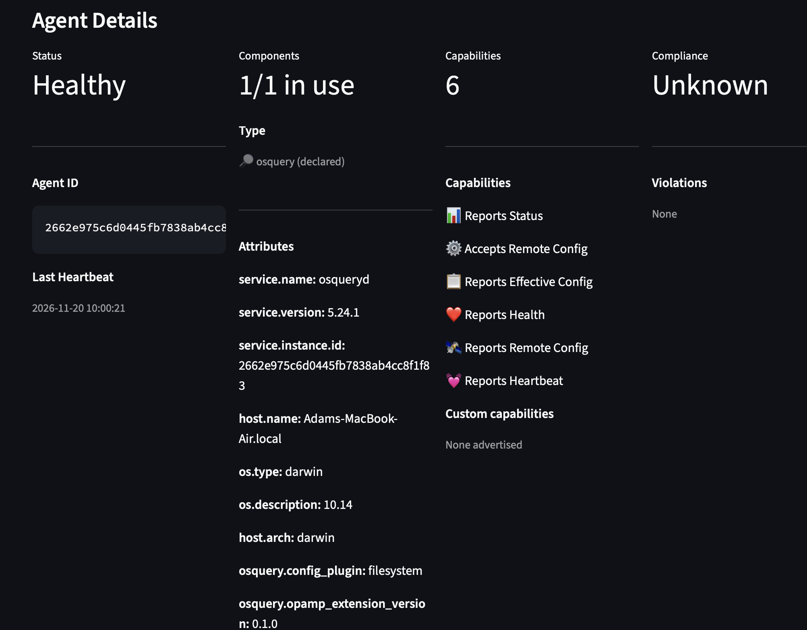

# osquery-opamp




An OpAMP agent for osquery, delivered as an **osquery extension**.

No changes to osquery's core. The extension registers with the daemon over the
documented Thrift API (`osquery/extensions/thrift/osquery.thrift`) and uses
registry calls that already exist:

| OpAMP need | osquery mechanism |
| --- | --- |
| deliver remote config | `--config_plugin=opamp` → `genConfig` (persistent, the recommended mode); `call("config", "update", ...)` → `Config::update()` merges a config source (push mode) |
| report what is actually running | `query("select ... from osquery_info / osquery_schedule")` |
| answer `--config_plugin=opamp` (pull mode) | the `config/opamp` registry item we advertise |

## Quick Start: Push Mode

`osqueryd` needs no modifications to be able to work with OpAMP. This repo runs alongside your standard osqueryd in a different terminal.

`osqueryd` can act in two different "modes": `push` mode or `pull` mode. The quickstart describes the most basic `push` mode.

1. Check that `--config_plugin=filesystem` listed
2. Generate an API token from your OpAMP server ([example server]())
3. Git clone this code (see below)
4. Start the osquery-opamp extension (see below)

```
git clone https://github.com/agardnerit/osquery-opamp
cd osquery-opamp
python -m venv .venv
source .venv/bin/activate
sudo .venv/bin/python -m osquery_opamp --header 'Authorization: Bearer <token>' --endpoint http://localhost:4320/v1/opamp
```

Where `<token>` is an auth token provided by [your OpAMP server](https://github.com/agardnerIT/opamp-server-py)

## Status

Working and tested against a real `osqueryd` 5.24.0 (65 tests, ~58s):

osquery side
- extension registration and liveness (the daemon pings us and drops us after two
  misses, so the extension serves its own Thrift socket)
- config push into the live schedule, per-source replacement semantics, and
  withdrawal (an empty `config_map`) that empties the pushed source in place
- config hash / validity read-back, scheduled-query read-back
- pull mode (`--config_plugin=opamp`), including a real daemon booting on a
  config served by `genConfig` - see "Push or pull?" below
- **config survives a restart.** The last accepted body and its OpAMP hash are
  cached (`--config-cache`, `0600`, atomic). A restarted extension or daemon is
  served it at boot, and in pull mode the agent re-reports `APPLIED` with the same
  hash so the server neither re-delivers nor counts it as unconfirmed. Before
  this, a daemon restart silently reverted the fleet to `--config_path`.
- the same code path on Windows, where the extension API is a named pipe
- concurrent RPC safety (one Thrift client, serialised - see below)

OpAMP side (spec v0.20.0)
- both transports: plain HTTP (the default, works against any server) and
  WebSocket, with `wss://`/`https://` CA verification. Chosen by the endpoint's
  scheme, so pointing the agent at a server is one flag
- gzip replies, and a bounded reply size before *and* after decompression
- honours the server's `Retry-After` on 429/503 as a backoff floor
- `AgentDescription` from `osquery_info`, honest capability bitmask
- remote config → `config/update`, with `APPLYING`/`APPLIED`/`FAILED` status
- pushed configs are **pre-compiled** before they are applied, so a schedule
  naming a table that does not exist is refused with osquery's own error instead
  of being reported as applied (`--no-validate-queries` opts out)
- effective config (when the server advertises `AcceptsEffectiveConfig`),
  including the config sources the daemon runs besides ours (filesystem plugin
  only, read back over `config/genConfig`)
- the daemon's live schedule, packs and config plugin in `ComponentHealth`
  attributes, refreshed every `--state-interval`
- duplicate query names across config sources reported as `config_conflict`
- `ComponentHealth`, heartbeats, `ReportFullState`, server-assigned `instance_uid`
- `com.osquery.query` custom capability (opt-in via `--enable-commands`)
- reconnect with exponential backoff, jitter and the spec's 30s floor
- `agent_disconnect` on clean shutdown

Not implemented, and not advertised in the capability bitmask
- `RESTART`: an extension has no RPC that restarts the daemon. A restart command
  is refused and surfaced in `ComponentHealth.last_error`. Config changes do not
  need one: the scheduler re-reads the merged schedule every tick, so an interval
  change takes effect on the next tick without restarting anything.
- packages, `own_metrics`/`own_traces`/`own_logs`
- connection settings (`ConnectionSettingsOffers`)
- the *merged* config: no RPC exposes it, so sources are reported instead


## HTTP (https://), Websockets (ws://) and Secure WebSockets (wss://)

Point it elsewhere with `--endpoint`. The scheme picks the transport:

```bash
--endpoint http://opamp.internal:4320/v1/opamp    # poll/reply, any server
--endpoint https://opamp.example.com/v1/opamp     # + --ca-file if not in the trust store
--endpoint ws://opamp.internal:4320/v1/opamp      # server can push without waiting for a poll
--endpoint wss://opamp.example.com/v1/opamp       # + --ca-file
```

WebSocket lowers delivery latency — a pushed config lands immediately instead of
on the next heartbeat — but costs a server-side opt-in on servers that do not
accept the upgrade by default. HTTP has no such requirement, which is why it is
the default and why a `WRONG_VERSION_NUMBER`/403 on the upgrade is a sign to drop
the `w` from the scheme rather than to start configuring the server.

`--tls-hostname` is `wss://` only: over `https://` the certificate must match the
URL host.

Add `--enable-commands` to allow ad-hoc SQL, `--source` to change the osquery
config source name, `--heartbeat`/`--retry` to tune timing, `--startup-timeout`
to wait longer for a daemon that is still starting, `--pull-wait` to bound how
long a pull-mode config request may block, `--state-interval` to change how often
the daemon's live schedule is read, and `--no-validate-queries` to push configs
without pre-compiling their SQL. `--help` lists all of them.

### Push or pull?

Two ways to wire this up. The difference is who owns the config.

**Pull (recommended).** osquery asks the OpAMP extension for its config; the OpAMP extension answers with what the
OpAMP server provided to us. Start the daemon with:

```bash
osqueryd --config_plugin=opamp --extensions_require=opamp --extensions_timeout=30
```

Both flags are required. With only `--config_plugin=opamp`, osqueryd exits at
startup with `Unknown registry plugin: opamp`.

That error has two causes that produce identical output: the agent is not
running, or `--extensions_require` is missing. The registry query under "Run it"
tells you which, and running the agent is the prerequisite either way.

In this mode osqueryd has no config file of its own: `--config_path` is ignored.
The last config the daemon accepted is cached by the agent, so a restart - of the
daemon, or of the whole machine - comes back up on that config even if the
server is unreachable. This is the only mode where the server is the source of
truth.

**Push.** Leave the daemon alone (it keeps `--config_plugin=filesystem`) and the
agent merges the server's config in at runtime as an extra config source.

The caveats are real, so read them:

- the file on disk is never modified - the pushed config lives in memory only
- a daemon restart discards it: after a reboot the host runs its file again
  until the server re-sends
- a query name that exists in both the file and the pushed config shows up in the
  schedule **twice**, carrying both intervals, so it can run at either.
  `RemoteConfigStatus` reports this as `config_conflict`.

So in push mode, treat the file and the server as two authors with a shared
namespace: either delete from the file what the server should own, or keep the
two sets of query names disjoint.

Use pull for anything long-lived. Use push for a pilot, or where you cannot
change the daemon's startup flags, and then only for query names the local file
does not define.

**Piloting?** Start with reporting only - let the agent send description, health
and the live schedule, and have the server send no config. Nothing can break,
and you find out whether the reports are accurate before config delivery is
turned on.

### Pull mode, in detail

Why `--extensions_require` is required rather than merely advised: it makes
osquery wait for the extension inside `startExtensionManager()`, which runs
before `initActivePlugin("config", ...)` and before config is loaded. Without
it, osqueryd does not degrade gracefully - it exits during startup:

```
E shutdown.cpp:80] Cannot activate opamp config plugin: Unknown registry plugin: opamp
```

(`--config_refresh` defaults to 0, so even a daemon that survived would never
retry.) The extension retries registration for `--startup-timeout` seconds for
the same reason: the daemon holds the manager socket open while it waits for us.

With that in place the daemon asks for config once. `genConfig` answers from the
config cache - the body the daemon last accepted - so a boot does not wait for
the OpAMP server and does not revert to `--config_path`. Only a completely cold
start (no cache yet) waits, up to `--pull-wait` seconds (default 10); if nothing
arrives the extension returns a failure rather than an empty config, and the
first push repairs the daemon without a restart.

Recommended daemon flags, because the cache only helps if nothing on the host
fights with it:

```bash
osqueryd --config_plugin=opamp --extensions_require=opamp --extensions_timeout=30 \
         --config_enable_backup=true
```

`--config_enable_backup` is osquery's own fallback: it copies config sources into
the daemon's database and restores them if the first refresh of a process fails.
Redundant while the cache answers, useful when the extension cannot start at all.

### Restart behaviour

| What restarts | Result |
| --- | --- |
| the extension | daemon keeps running with its config |
| the daemon, extension still up | re-registers with a new uuid and rebinds; no relaunch needed |
| the host, pull mode | same: the extension loads the cache and answers the boot-time `genConfig` |
| the daemon, push mode (`--config_plugin=filesystem`) | **not** restored - the daemon re-reads its own file, the agent reports `UNSET`, the server re-delivers and the source is re-created |

The mode is detected from the daemon and logged at startup (`config mode: PULL` /
`config mode: PUSH`), because "a restart keeps the config" is true in only one
of them.

The extension is supervised the same way: a daemon restart (including the
`Extension.shutdown()` that a clean `osqueryctl restart` sends) makes it re-register
in a loop with backoff rather than exit, so a daemon with
`--extensions_require=opamp` always finds its config plugin. Only a signal to the
agent itself, or 300s of the daemon not coming back, stops it. A second copy of the
agent is a different matter: the daemon refuses duplicates while the first is
answering pings, so the agent fails after `--startup-timeout` with the reason and
the fix rather than looping. `--config-cache ''` disables persistence on hosts where a durable file
is not wanted.

## Requirements

- osqueryd (tested with 5.24.0; the macOS `.pkg` only symlinks `osqueryi` and
  `osqueryctl` into `/usr/local/bin`, so point `OSQUERYD` at the bundle path)
- Windows: supported via named pipes (`src/osquery_opamp/winpipe.py`). No
  extra dependency - the kernel32 bindings are ctypes. The transport is covered
  by `tests/test_winpipe.py` on every platform and by
  `tests/test_windows_daemon.py` against a real `osqueryd.exe`, which only runs
  on Windows
- Python 3.10+ with `thriftpy2`, `protobuf>=7.34.1,<8`, `websocket-client`

## Development

```bash
python3 -m venv .venv
.venv/bin/pip install -e '.[test]'
.venv/bin/python -m pytest tests/ -q          # boots real osqueryd instances
```

Tests run the daemon unprivileged with `--ephemeral --disable_database` and
temporary paths, so they need no root and leave no state behind. Set
`OSQUERYD=/path/to/osqueryd` to override the binary.

## Layout

```
src/osquery_opamp/osquery_thrift.py   vendored IDL loader, socket paths, client/server factories
src/osquery_opamp/opamp/transport.py  HTTP and WebSocket transports, chosen by URL scheme
src/osquery_opamp/winpipe.py          Windows named-pipe transport (client and server)
src/osquery_opamp/core.py             typed wrapper over the daemon's registry calls
src/osquery_opamp/extension.py        registration, liveness, Thrift Extension service
vendor/osquery.thrift                 copied from osquery (Apache-2.0)
vendor/opamp.proto, proto/*_pb2.py    OpAMP v0.20.0 definitions
tests/                                real-daemon integration tests
```

## Behaviour worth knowing

`Config::update()` only rejects **unparseable JSON** (and the size limit).
Verified against 5.24.0: `{"schedule": []}`, unknown top-level keys, and
scheduled queries naming tables that do not exist all return OK. osquery applies
config structure eagerly and validates SQL at execution time.

So an OpAMP `APPLIED` status means "accepted and merged", **not** "the queries
work". Per-query failures show up in `osquery_schedule` and the status logs. See
`docs/opamp-contract.md`.

**Withdrawal is honoured.** The spec has no "delete the config" message: a
server withdraws by sending a `RemoteConfig` with an empty `config_map`. The agent
reports `APPLIED` and pushes `{}` under its own source, which `Config::update()`
replaces in place, so a daemon in push mode goes back to scheduling only what its
own file says (and in pull mode `genConfig` answers `{}` - it runs nothing rather
than the config it was told to forget). Reporting that as `FAILED`, as this did
before, poisoned the revision *and* left the pushed source merged in the daemon
with no RPC to remove it: the only way back to the local file was restarting
`osqueryd`.

Except: the agent compiles every scheduled query before pushing, so a config
that would fail at execution time is refused with osquery's own error text
(`scheduled query 'battery' does not compile: no such table: batteries`) and the
previous config keeps running. `--no-validate-queries` restores the old
push-and-hope behaviour.

## Two bugs the tests found, for the record

- **Unserialised Thrift client.** The liveness thread pings the daemon while the
  OpAMP thread pushes config; one client, one socket, interleaved responses. It
  presented as "the server's config was never applied". `CoreClient` now holds a
  lock, and `test_core_client_is_safe_under_concurrent_rpcs` keeps it honest.
- **`TThreadedServer.close()` does not unblock `accept()`.** Shutdown cost a full
  join timeout per extension until `stop()` started poking the socket.
